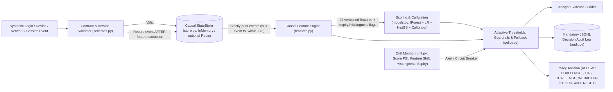

# Architecture — Account Takeover Detection Engine

## 1. Overview and Boundaries

The Account Takeover Detection Engine separates **contract validation**, **causal feature generation**, **model training & calibration**, **adaptive step-up policy & fallback**, **drift monitoring**, **mandatory decision audit logging**, and **HTTP serving** into distinct modules under `src/ato_engine/`.

## 2. Core Data Flow

1. **Contract Validation (`schemas.py`)**: Enforces UTC timezone-aware timestamps, valid coordinate/score/IP ranges, strict schema/enum support, and rejects unknown fields (`extra="forbid"`). Distinguishes contract violations (`ContractValidationError` / HTTP 422) from unsupported versions or action types (`UnsupportedInputError` / HTTP 400).
2. **Causal Feature Generation (`features.py`, `store.py`)**: Queries only events strictly earlier than the target event (`history_ts < event_ts`) and inside configured TTL windows (1h, 24h, 30d). Explicitly tracks feature expiry (`profile_expired`) and telemetry missingness (`missing_feature_ratio`). The current event is written to the `StateStore` **after** feature extraction completes.
3. **Anomaly, Supervised & Calibrated Scoring (`models.py`)**:
   - **Reference Oracle**: Hand-calculated linear rule score (`rule_oracle_score`) established as a transparent baseline.
   - **Anomaly Baseline**: `IsolationForest` fitted on standardized historical training features, rescaled to `[0, 1]`.
   - **Supervised Baselines**: Balanced `LogisticRegression` (interpretable linear baseline + feature attribution weights) and `HistGradientBoostingClassifier` (nonlinear baseline).
   - **Chronological Validation & Label Maturity**: Splits chronologically into Train / Calibration / Test. Training rows are included **only** when `label_available_at <= train_cutoff` (preventing delayed-label leakage).
   - **Post-hoc Calibration**: Platt scaling (sigmoid) or isotonic regression fitted strictly on the chronological calibration split after training cutoff and before test evaluation.
4. **Adaptive Policy, Analyst Evidence & Fallback (`policy.py`)**:
   - Adjusts step-up thresholds dynamically for `high_value` accounts (tighter), peaceful `shared_network` NATs (dampened to avoid false blocks), and active drift alerts (tighter).
   - Enforces deterministic safety guardrails for repeated failed attempts (5+ -> WebAuthn, 10+ -> Block), impossible travel + sensitive action bursts, and expired profiles.
   - Falls back automatically to a deterministic conservative rule policy on missing/stale models, store outages, excessive missing features (`>= 50%`), or critical drift circuit-breaker engagement.
   - Generates ranked analyst evidence (`top_factors`, `triggered_rules`, `missing_fields`, `recommended_playbook`).
5. **Mandatory Audit Logging & Replay (`audit.py`)**: Every decision produced by `ATODetectionEngine.evaluate()` is appended to a structured JSONL audit log with a deterministic `decision_id` derived from `(event_id, timestamp, model_version, feature_version, policy_version)`.

## 3. Key Invariants

- **No future events in features**: Both `StateStore` range queries (`ts < before_ts`) and `assert_no_future_events()` inside `compute_features()` enforce strict causality.
- **No delayed-label leakage**: `chronological_split_with_maturity()` excludes training events whose `label_available_at` exceeds `train_cutoff`.
- **Every decision logged**: `ATODetectionEngine.evaluate()` unconditionally invokes `DecisionAuditLogger.log_decision()` for normal and fallback decisions alike.
- **No silent failure**: Invalid configs raise `ConfigurationError`; tampered artifacts raise `ModelArtifactError`; degraded runtime dependencies trigger explicit `fallback_used=True` with a typed `FallbackReason`.
- **Synthetic-only scope**: Uses RFC 5737 documentation IPs (`192.0.2.0/24`, `198.51.100.0/24`, `203.0.113.0/24`) and synthetic IDs; no real credentials or PII.

## 4. Key Trade-offs

| Decision | Choice | Trade-off |
|---|---|---|
| State store default | `InMemoryStateStore` with optional `RedisStateStore` | Zero external infrastructure for reproducible local runs and CI; single-process memory does not persist across restarts unless Redis is enabled. |
| Model ensemble | `IsolationForest` + `LogisticRegression` + `HistGradientBoostingClassifier` + Platt calibration | Strong discrimination, calibrated probabilities, and interpretable linear attributions with fast CPU inference; less expressive than deep sequence models on long multi-session graphs. |
| Fallback posture | Conservative step-up (minimum `CHALLENGE_OTP` on store outage or >50% missing telemetry) | Prevents silent fail-open during outages at the cost of temporary user friction during degraded telemetry. |
| Calibration split | Dedicated chronological holdout between train and test | Prevents optimistic calibration leakage while reducing available training rows slightly. |
