# Architecture & Design Decisions

## 1. System Architecture

The engine enforces strict architectural boundaries between **I/O & APIs**, **pure domain computation**, **ML lifecycle stages** (feature generation, training, calibration, policy, inference), and **auditable case persistence**.

```mermaid
flowchart LR
    subgraph Ingestion["1. Ingestion & Contracts"]
        RAW["Raw Batch JSON / API Payload"] --> VAL["Schema & Unit Validation"]
        VAL --> NORM["Normalization, FX -> USD, Deduplication & Entity Resolution"]
    end

    subgraph Features["2. Pure Feature Layer (Versioned v1.0.0)"]
        NORM --> ROLL["Point-in-Time Rolling Windows (1h / 24h / 7d / 30d)"]
        NORM --> GRAPH["Directed Temporal Transaction Graph (+ Optional NetworkX Adapter)"]
    end

    subgraph Detection["3. Detection & ML Prioritization"]
        ROLL --> SCEN["5 Configurable Scenario Detectors"]
        GRAPH --> SCEN
        SCEN --> FEAT["Candidate Feature Extractor"]
        FEAT --> ML["Calibrated LogReg + Platt Prioritizer (Temporal Split + Label Maturity)"]
        SCEN --> POL["Policy Layer (Rule + ML Tiering: P1 / P2 / P3)"]
        ML --> POL
    end

    subgraph Workflow["4. Case Review & Provenance"]
        POL --> ALERT["Explainable Advisory Alert + SHA-256 EvidenceRecord"]
        ALERT --> CASE["Case Workflow (OPEN -> IN_REVIEW -> ESCALATED / CLOSED)"]
        CASE --> AUDIT["Append-Only Hash-Chained Audit Trail & Override Enforcement"]
        AUDIT --> REPO["CaseRepository (SQLite Default / Optional PostgreSQL)"]
    end
```

## 2. Explicit Boundaries & Invariants

1. **Domain Isolation from I/O**:
   - `normalization.py`, `features/rolling.py`, `features/graph.py`, `detection/scenarios.py`, `ml/prioritizer.py`, and `case_management/workflow.py` perform zero network or database I/O and accept/return typed immutable dataclasses (except `Case` state transitions).
2. **ML Lifecycle Separation**:
   - **Feature Generation**: `extract_candidate_features()` produces a fixed, versioned 13-feature schema (`FEATURE_NAMES`, `feature_version="1.0.0"`).
   - **Training**: `MLPrioritizer.fit()` trains L2-regularized logistic regression solely on matured records strictly before `train_end - label_maturity_days`.
   - **Calibration**: Platt scaling (`platt_a`, `platt_b`) is fit strictly on the chronologically subsequent matured calibration slice (`[train_end, cal_end - maturity_days]`).
   - **Policy**: `apply_prioritization_policy()` combines rule scores and calibrated probabilities using versioned policy weights and tier thresholds (`policy_version="1.0.0"`).
   - **Inference**: `predict_and_explain()` outputs raw probability, calibrated probability, and exact per-feature log-odds attributions.
3. **No Future Leakage**:
   - Rolling windows evaluate strictly over `[t - W, t]` in deterministic `(timestamp_utc, tx_id)` order.
   - Temporal ML splits exclude immature records within `label_maturity_days` of split boundaries.
4. **Deterministic Replay & Provenance Invariant**:
   - `alert_id`, `evidence_id`, `case_id`, and `run_id` are SHA-256 hashes of canonical JSON payloads. Replaying the exact same batch produces identical IDs and reuses persisted cases cleanly (`cases_created=0`, `cases_reused_on_replay=N`).
5. **No Automatic Accusation Invariant**:
   - Every `Alert` and `Case` carries `ADVISORY_NOTICE`, initializes in `OPEN / PENDING_ANALYST_REVIEW`, rejects `SYSTEM_MONITOR` as a human reviewer, and requires explicit human audit fields on every disposition and override.

## 3. Trade-Offs

| Decision | Chosen Approach | Trade-Off / Rationale |
|---|---|---|
| Core runtime dependencies | Pure Python 3.9+ stdlib core + optional `FastAPI`, `NetworkX`, `psycopg` adapters | Guarantees deterministic clean-checkout reproducibility even offline, while preserving drop-in compatibility with the suggested stack |
| ML prioritization model | Pure-Python L2 Logistic Regression + Platt scaling | Fully transparent exact linear log-odds explainability and zero native-binary drift vs higher nonlinear capacity of gradient boosted trees |
| Graph traversal bounds | Bounded DFS (`max_hops=5`, explicit time & value preservation bounds) | Predictable polynomial runtime on micro-batches while avoiding exponential path explosion on dense merchant hubs |
| Alert grouping granularity | Grouped by `(subject_account_id, trigger_date)` | Prevents analyst alert fatigue from overlapping sub-window triggers while preserving every contributing transaction in `involved_tx_ids` |

---

## 4. Architecture Decision Record (ADR-001)

- **ID**: ADR-001
- **Title**: Zero-Dependency Pure-Python Core with Optional Stack Adapters (FastAPI, NetworkX, PostgreSQL)
- **Status**: Accepted
- **Context**: `plan.md` suggests Python, NetworkX, PostgreSQL, and FastAPI, while also requiring deterministic offline reproducibility from a clean checkout and explicit handling of unavailable dependencies. Target developer environments may lack external package mirrors or a running PostgreSQL server.
- **Decision**:
  1. Implement the entire monitoring domain (normalization, rolling aggregations, temporal directed multi-graph, scenario rules, calibrated ML prioritizer, case workflow, audit hash chain) in pure Python 3.9+ standard library.
  2. Provide `SQLiteCaseRepository` and `http_server.py` as default local persistence and HTTP transport.
  3. Provide clean adapter modules (`TransactionGraph.to_networkx()`, `PostgresCaseRepository` + `schema_postgres.sql`, and `create_fastapi_app()`) pinned in `requirements-optional.txt`.
- **Consequences**:
  - Positive: 100% of core unit, integration, evaluation, and demo checks run out-of-the-box in <1 second with zero external setup.
  - Trade-off: Optional PostgreSQL, FastAPI, and NetworkX execution paths must be explicitly tracked as `Not Run` whenever those optional extras are absent in the validation environment.
