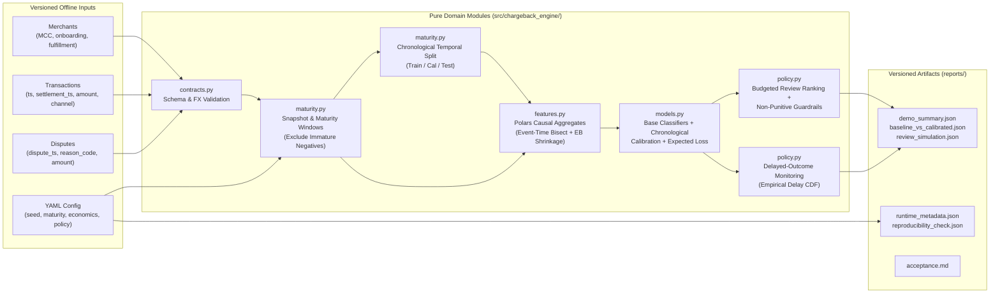

# Architecture — Chargeback Prediction Engine

## 1. System overview

The Chargeback Prediction Engine is an offline, deterministic research and engineering prototype that predicts delayed payment dispute risk, produces calibrated expected dispute loss estimates, prioritizes manual review queues under fixed analyst budgets, and simulates delayed-outcome cohort monitoring.

**Design separation:** Feature generation, label maturity assignment, temporal splitting, model training, post-hoc calibration, economic decision policy, and inference/monitoring are separated into distinct modules with explicit typed contracts and zero I/O inside domain functions.

## 2. Component and data-flow diagram

## 3. Core architectural invariants

1. **No immature negatives in training or negative evaluation:** Any transaction with `as_of_ts < maturity_date` and no observed dispute as of `as_of_ts` is assigned `label_status = immature_negative`, `label = null`, and `is_trainable = false`. Default `cohort_mature` mode also excludes `immature_positive` rows from training/calibration so base rates remain unbiased by right-censoring (see [ADR-0001](adr/0001-maturity-windows-and-causal-features.md)).
2. **Strict event-time causality in features:** At transaction timestamp $t$, merchant velocity/volume features use only transactions with $\text{tx\_ts} < t$; trailing reported disputes use only disputes with $\text{dispute\_ts} < t$; mature merchant rates count only prior transactions with $\text{maturity\_date} \le t$ and $\text{dispute\_ts} \le t$.
3. **Chronological holdout and chronological calibration:** Train, calibration, and test splits are strictly ordered in time (`max(train_ts) <= min(cal_ts)` and `max(cal_ts) <= min(test_ts)` with optional embargo days). Post-hoc probability calibration (Platt/sigmoid or isotonic) is fitted solely on the temporal calibration split.
4. **Disputes are not equivalent to fraud (non-punitive guardrails):** Policy actions are strictly limited to `manual_review` or `approve`. Attempting to enable `allow_automated_merchant_punishment: true` raises `ConfigError`. High merchant review concentration triggers a non-punitive `analyst_merchant_health_check` advisory.
5. **Reproducibility:** Fixed RNG seeds, deterministic sorting tie-breakers (`(ts, id)`), pinned dependencies (`requirements.lock`), versioned feature schema hashes, and deterministic `run_id` / `model_id` identifiers.

## 4. Key trade-offs

| Decision | Chosen Approach | Trade-off / Alternative |
|---|---|---|
| Label maturity mode | Default `cohort_mature` (exclude both immature negatives and immature positives from training/calibration) | Delays freshest cohort from training by `default_maturity_days` (90d), mitigated by delayed-outcome monitoring using the empirical arrival CDF. Alternative `exclude_immature_negatives_only` is supported for sensitivity analysis. |
| Model stack | `scikit-learn` (`HistGradientBoostingClassifier`, `LogisticRegression`) + `Polars` | Zero native `libomp` build fragility on macOS/Linux while retaining gradient-boosted tabular performance and fast tabular processing. LightGBM can be plugged in via `_build_base_estimator` if desired. |
| Cold-start merchants | Empirical Bayes shrinkage toward training-set global mature dispute rate | Smooth, well-calibrated prior with zero division-by-zero edge cases; relies on global prior accuracy until merchant accumulates matured transactions. |
| Post-hoc calibration | Platt scaling (`sigmoid`) fitted on chronological calibration split | Low-variance parametric calibration robust under severe class imbalance (1–3% positives); `isotonic` is also supported when calibration positives are abundant. |
