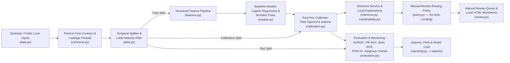

# Architecture — Credit Risk Scoring Platform

## 1. System Overview and Component Boundaries

The platform separates data validation, point-in-time feature extraction, model training, probability calibration, evaluation diagnostics, decision-support policy routing, inference, and human manual review into independent Python modules under `src/credit_risk/`.

## 2. Core Invariants

1. **Temporal Causality & Leakage Isolation:**
   - Every applicant record passes `validate_applicant_record()` before entering feature extraction or scoring.
   - `feature_as_of_timestamp <= application_timestamp` and zero post-origination columns are enforced structurally.
   - Feature medians, standardization means/stds, and base models are fitted **only** on the chronological `train` split.
   - Calibrators are fitted **only** on the chronological `calibration` split.
   - Immature labels (`as_of_cutoff_date < label_maturity_date`) are segregated into `censored_excluded` and never enter training, calibration, or evaluation.
2. **Protected Attribute Isolation:**
   - `age_band` and `region_tier` are validated on `ApplicantRecord` strictly for post-hoc subgroup diagnostics and are programmatically asserted absent from `FeaturePipeline.feature_names_`.
3. **Calibration & Policy Monotonicity:**
   - Every fitted `PDCalibrator` runs `verify_monotonicity()` across a dense `[0.001, 0.999]` score grid.
   - `ManualReviewPolicy` enforces strictly increasing `max_pd` risk-band cutoffs ending at `1.0` and verifies that risk-band severity is non-decreasing and review SLA hours are non-increasing as calibrated PD increases.
4. **No Automated Lending Decisions:**
   - `policy.automated_decision_allowed` is enforced `False` at config parsing, policy construction, inference output, and manual-review store layers.
   - Human dispositions (`HUMAN_REVIEW_CLEARED`, `HUMAN_REQUEST_DOCUMENTATION`, `HUMAN_ESCALATED_COMMITTEE`, `HUMAN_DECLINE_RECOMMENDATION`) require non-empty `reviewer_id` and `rationale`.
5. **Reproducibility & Replayability:**
   - Fixed random seeds (`project.seed`) govern synthetic data generation and estimator fitting.
   - `decision_id` is a deterministic SHA-256 digest over canonical applicant payload and model/feature/calibration/policy versions, enabling exact replay verification (`CreditRiskScorer.replay_decision()`).

## 3. Design Trade-offs

| Decision | Chosen Approach | Trade-off / Rationale |
|---|---|---|
| Default boosted model | `sklearn.ensemble.HistGradientBoostingClassifier` with optional `xgboost` adapter | Zero compiled C++/OpenMP setup friction on macOS/Linux CI while preserving a drop-in XGBoost adapter when installed |
| Default local explanations | Exact linear log-odds (LR) & vectorized baseline-perturbation marginal log-odds (GBDT) with optional `shap` | Deterministic, fast, and dependency-light; `shap` TreeExplainer can be enabled when installed without changing output schemas |
| Calibration window | Dedicated chronological holdout split | Slightly smaller training set than out-of-fold calibration, but faithfully reflects forward-in-time calibration under regime drift |
| Manual review UI | Built-in Python `http.server` + JSON audit store | Zero external web-framework runtime dependencies and effortless local inspection (`scripts/run_review_ui.py`) |
| Small-subgroup handling | Strict error (`InsufficientSubgroupSampleError`) or explicit `INSUFFICIENT_SAMPLE` withholding | Prevents misleading fairness claims from noisy small-N slices |
