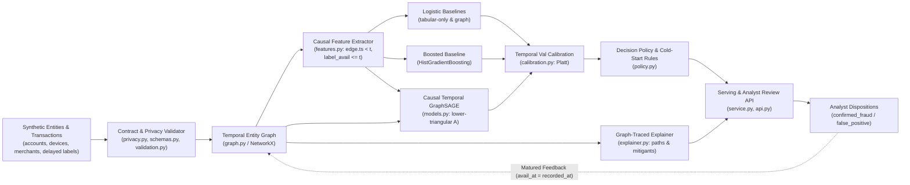

# Architecture — Graph-Based Fraud Detection Engine

## 1. System overview

The Graph-Based Fraud Detection Engine scores coordinated fraud rings while separating them from benign multi-user patterns (such as household or kiosk shared devices). Every layer enforces strict temporal causality (`edge.timestamp < tx_timestamp` and `label.label_available_at <= tx_timestamp`) and privacy-safe pseudonymized identifiers (`acc_*`, `dev_*`, `mer_*`, `tx_*`).

## 2. Module boundaries

| Layer | Module | Responsibility |
|---|---|---|
| Configuration | `src/graph_fraud_engine/config.py` | Fail-fast YAML configuration validation (`ConfigurationError` on missing/invalid config) |
| Privacy | `src/graph_fraud_engine/privacy.py` | Deterministic HMAC-SHA256 pseudonymization (`acc_`, `dev_`, `mer_`, `tx_`) and PII guard |
| Data contracts | `src/graph_fraud_engine/schemas.py`, `validation.py` | Pydantic v2 schemas, UTC timestamp normalization, referential integrity, label maturity order |
| Temporal graph | `src/graph_fraud_engine/graph.py` | Time-aware heterogeneous graph (`USES_DEVICE`, `TRANSACTS_AT`, `OBSERVED_AT`) and causal NetworkX subgraphs |
| Features | `src/graph_fraud_engine/features.py` | 20 strictly causal features (velocity, shared-device merchant mix, 2-hop ring fraud exposure, triangulation, cold-start flags) |
| Modeling | `src/graph_fraud_engine/models.py` | Tabular-only logistic baseline, graph logistic baseline, imbalance-weighted HistGradientBoosting, 2-layer causal `TemporalGraphSAGEModel` |
| Calibration & metrics | `src/graph_fraud_engine/calibration.py`, `metrics.py` | Temporal splits with label maturity filtering, Platt/Isotonic calibration, PR-AUC, recall@fixed-FPR, ECE, Brier |
| Explanations | `src/graph_fraud_engine/explainer.py` | Graph-traced evidence paths, co-account triangulation paths, reason codes, legitimate shared-device mitigant |
| Policy & serving | `src/graph_fraud_engine/policy.py`, `service.py`, `api.py` | Risk decisioning (`approve`/`review`/`block`), cold-start review thresholds, FastAPI endpoints, analyst review queue & disposition recording |

## 3. Core invariants

1. **No future edges in features or GNN message passing**:
   - Every historical edge lookup enforces `edge.timestamp < tx_timestamp` and `edge.tx_id != tx_id`.
   - The GNN causal transaction adjacency matrix `A` is strictly lower-triangular (`A[i, j] = 0` whenever `t_j >= t_i`), guaranteeing that both 1-hop (`A @ X`) and 2-hop (`A @ A @ X`) propagation cannot access future transactions.
2. **Delayed label maturity**:
   - Feature lookups only include fraud labels where `label_available_at <= tx_timestamp` and `tx_timestamp < as_of`.
   - Training and validation splits exclude any transaction whose `label_available_at > split_cutoff` when `enforce_label_maturity: true`.
3. **Explanations trace to graph**:
   - Every `RiskScoreResponse` contains `evidence_paths` whose nodes and edges come directly from the temporal graph at `as_of`, along with `graph_audit_max_edge_timestamp < tx_timestamp`.
4. **Distinguishing fraud rings from legitimate shared devices**:
   - Shared device degree alone is insufficient because households and kiosks also share devices. The graph features combine multi-account 24h bursts, device high-risk merchant ratio, 2-hop co-account matured fraud, and merchant cash-out triangulation, while explicitly surfacing `LEGITIMATE_SHARED_DEVICE_MITIGANT` on low-risk routine shared devices.

## 4. Trade-offs

- **Native NumPy TemporalGraphSAGE vs PyTorch Geometric**: PyTorch Geometric is optional (`pyproject.toml` `[project.optional-dependencies].pyg`). Implementing a deterministic 2-layer causal GraphSAGE in NumPy avoids multi-gigabyte native binary dependencies while delivering genuine 2-hop message-passing training, inductive single-transaction inference, and bit-for-bit reproducibility on CPU.
- **In-memory graph & review store**: Suitable for an offline educational/research prototype; production systems would back the temporal graph and analyst review queue with durable transactional stores and streaming event pipelines.
