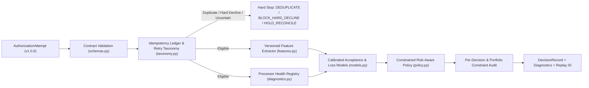
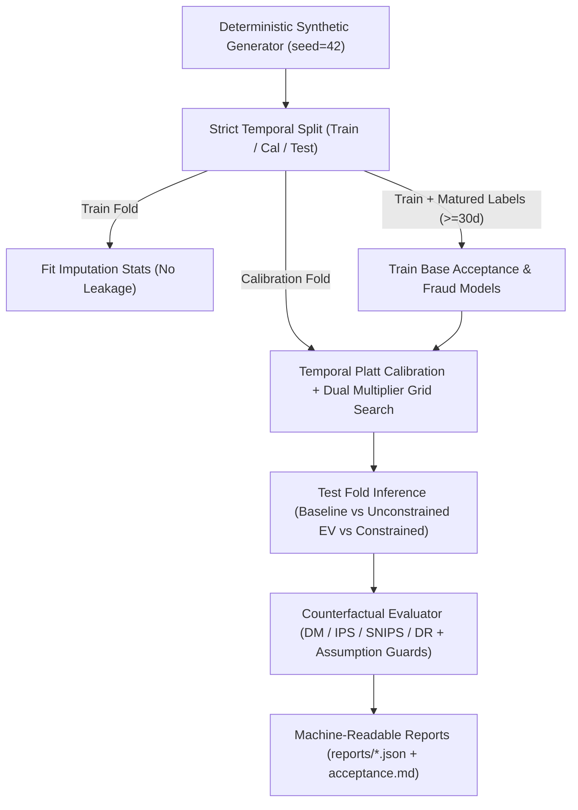

# Architecture — Payment Authorization Optimization Engine

## 1. System Overview

The Payment Authorization Optimization Engine is an offline, synthetic research prototype structured into strictly separated layers: **Contract Validation**, **Retry Safety & Deduplication**, **Versioned Feature Engineering**, **Calibrated Acceptance & Loss Modeling**, **Constrained Decision Policy**, **Counterfactual Evaluation**, and **FastAPI / CLI Delivery**.

## 2. Offline Training, Calibration & Counterfactual Flow

## 3. Core Architectural Boundaries

| Boundary | Module | Responsibility | Isolation Guarantee |
|---|---|---|---|
| Data contracts | `schemas.py` | Strict Pydantic v2 schemas, ISO units, UTC enforcement, typed `ContractValidationError` | No model or I/O imports |
| Response taxonomy & retry | `taxonomy.py` | ISO-8583 / gateway taxonomy and deterministic retry eligibility state machine | Pure function; isolated from I/O and ML |
| Feature engineering | `features.py` | Versioned feature matrix (`1.0.0`), training-only imputation, explicit missingness flags, temporal split & label maturity filter | Stateless `transform()`; fit only on train split |
| Modeling & calibration | `models.py` | Calibrated acceptance $P(\text{approve}\mid x,a)$ and matured fraud $P(\text{fraud}\mid x,\text{approved},a)$, ECE/Brier/AUC tracking, model manifest export | Independent from policy thresholds and HTTP layer |
| Decision policy | `policy.py` | `BaselineThresholdPolicy`, `UnconstrainedEVPolicy`, `ConstrainedRiskAwarePolicy`, portfolio constraint audit | Operates only on typed `ActionPrediction`s |
| Counterfactual evaluation | `counterfactual.py` | DM, IPS, SNIPS, DR estimators, bootstrap confidence bounds, positivity & ESS assumption checks, oracle error comparison | Pure numerical module; explicit `CounterfactualAssumptionError` |
| Runtime & delivery | `engine.py`, `diagnostics.py`, `api.py`, `cli.py` | Orchestration, processor health registry, idempotency ledger, deterministic `decision_id`, replay verification, FastAPI & CLI | Thin shell over pure domain layers |

## 4. Key Safety & Statistical Invariants

1. **No blind retry of hard declines:** Response codes `14`, `54`, `57`, `59`, `63` unconditionally map to `BLOCK_HARD_DECLINE`.
2. **No blind retry of uncertain outcomes:** `TIMEOUT`, `NETWORK_ERROR`, `UNKNOWN`, unmapped codes, or `prior_outcome_known=False` unconditionally map to `HOLD_RECONCILE`.
3. **No double-charging on duplicates:** Seen `idempotency_key` or already-approved `transaction_id` maps to `DEDUPLICATE_RETURN_PRIOR`.
4. **Fail-closed on total processor outage:** If primary processor is in `OUTAGE`, traffic fails over to a healthy/degraded secondary processor; if all configured processors are in `OUTAGE`, the engine returns `BLOCK_PROCESSOR_OUTAGE`.
5. **No temporal or label-maturity leakage:** `max(train_ts) <= min(cal_ts) <= max(cal_ts) <= min(test_ts)` is asserted in code; loss models train exclusively on outcomes with `label_maturity_days >= min_label_maturity_days`.
6. **Zero hidden constraint breaches:** Every constrained decision carries explicit `ConstraintCheckResult` entries, and portfolio evaluation verifies expected loss (bps) and P95 latency (ms) against configured budgets.

## 5. Engineering Trade-Offs

- **Linear/Platt models vs. GBDT:** Standardized L2 logistic regression with temporal Platt scaling provides monotonic, interpretable feature contributions (`top_contributing_factors`), low calibration error (ECE), and exact cross-platform reproducibility. Non-linear models can be swapped behind `AuthorizationModelBundle` without modifying policy or API layers.
- **Lagrangian grid search vs. online LP:** Grid search over $(\lambda_{\text{loss}}, \lambda_{\text{latency}})$ on the calibration fold is deterministic, transparent, and fast (~1 s for 4,000 samples). In non-stationary production environments, dual multipliers would require periodic recalibration with drift monitoring.
- **Synthetic counterfactual oracle:** Generating synthetic logged data with known propensities enables exact verification of off-policy DR bias/variance against a true oracle, while clearly delineating that observational data without known logging propensities cannot establish causal uplift.
