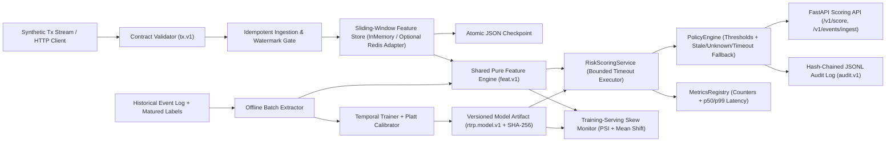

# Architecture Overview

## 1. Component Diagram

## 2. Architectural Boundaries

1. **Pure Domain Layer (`schemas.py`, `features.py`, `policy.py`, `monitoring.py`)**:
   - Contains zero network, filesystem, or framework I/O.
   - `compute_point_in_time_features()` is the **single source of truth** shared between offline batch extraction (`OfflineFeatureExtractor`) and online sliding-window retrieval (`InMemoryFeatureStore`).
2. **State & Persistence Layer (`store.py`, `audit.py`, `model.py`)**:
   - `InMemoryFeatureStore` provides thread-safe sliding-window retention, idempotent deduplication (`event_id` -> `payload_hash`), watermark lateness filtering, freshness tracking, and atomic checkpointing (`os.replace`).
   - `AuditLogger` appends hash-chained JSONL records (`prev_hash` -> `record_hash`) enabling offline tamper checks and exact decision replay.
   - `CalibratedLinearRiskModel` uses pure-Python/math inference on a SHA-256 verified JSON artifact so serving does not depend on scikit-learn runtime overhead or unsafe `pickle` deserialization.
3. **Training & Calibration Layer (`synthetic.py`, `training.py`)**:
   - Strictly chronological train / calibration / test split with label maturity enforcement (`label_ts <= split_snapshot_ts`).
   - Fits L2-regularized logistic regression on the train split and Platt sigmoid calibration on the temporal calibration split, then records test Brier/ECE/AUC and reference feature histograms inside the versioned artifact.
4. **Orchestration & Serving Layer (`service.py`, `api.py`, `metrics.py`)**:
   - `RiskScoringService` enforces a wall-clock `inference_timeout_ms` budget via a bounded thread pool; timeouts or runtime errors fall back deterministically to `fallback.rules.v1`.
   - FastAPI exposes `/health`, `/metrics`, `/v1/models/active`, `/v1/events/ingest`, `/v1/score`, and `/v1/audit/replay`.

## 3. Core Invariants

- **Offline/Online Feature Parity**: For any canonical event sequence, online feature vectors computed prior to ingestion match offline point-in-time batch vectors within `1e-9` absolute tolerance.
- **Idempotency Without Silent Corruption**: Re-ingesting the same `event_id` with an identical canonical payload is a no-op (`DUPLICATE_IGNORED`); re-ingesting with a mutated payload raises `DuplicateConflictError`.
- **Conservative Failure Mode**: Stale cached features, unknown MCC/country inputs, model timeouts, and model runtime errors never silently auto-approve high-value or high-risk transactions.
- **Full Decision Traceability**: Every decision carries `decision_id`, `model_version`, `feature_version`, `policy_version`, `feature_freshness_ms`, `feature_status`, and `reason_codes`.
- **No Sensitive Data**: Raw 13–19 digit PAN patterns are rejected at the contract boundary.

## 4. Key Trade-Offs

- **In-memory sliding-window store + atomic JSON checkpoint vs. live Redis/Kafka**: Keeps the research prototype self-contained, deterministic, and runnable offline in CI with zero external daemons, while isolating `FeatureStore` behind a protocol so Redis/Kafka adapters can plug in later.
- **Pure-math JSON model artifact vs. pickle/joblib**: Eliminates arbitrary-code-execution risks of `pickle`, provides human-inspectable weights + SHA-256 verification, and delivers sub-millisecond scoring latency.
- **Platt scaling over isotonic regression**: Smooth, monotonic 2-parameter calibration (`platt_a`, `platt_b`) that generalizes stably on modest temporal calibration slices without piecewise step artifacts.
