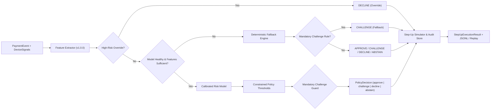

# Architecture — Smart Payment Authentication Engine

## 1. Overview and Boundaries

The Smart Payment Authentication Engine separates its lifecycle into five isolated layers so that modeling, calibration, business policy, step-up simulation, and serving can evolve independently without silent coupling or label leakage:

1. **Data Contracts & Synthetic Generation (`contracts.py`, `data_generator.py`):** Strict Pydantic v2 schemas for `PaymentEvent`, `DeviceSignals`, `RiskLabel`, `ChallengeOutcome`, `PolicyDecision`, and `StepUpExecutionResult`.
2. **Versioned Feature Engineering (`features.py`):** Deterministic feature extraction (`v1.0.0`) with explicit tracking of missing fields (`missing_fields`, `missing_feature_ratio`) decoupled from model imputation.
3. **Temporal Training & Calibration (`training.py`, `calibration.py`):** Chronological split (`train < cal < val < test`) with strict delayed-label maturity gating (`label_available_at <= as_of_time`), scikit-learn risk modeling, post-hoc Platt/isotonic probability calibration, and SHA-256 verified artifact manifests.
4. **Pure Domain Policy & Optimization (`policy.py`):** I/O-free decision logic enforcing strict precedence invariants, deterministic fallback, and constrained threshold optimization over `(challenge_threshold, decline_threshold)` producing a Pareto tradeoff frontier.
5. **Step-Up Simulation, Serving & Audit (`step_up.py`, `inference.py`, `store.py`, `api.py`, `evaluation.py`):** Per-decision seeded step-up simulator, structured JSON audit logging, diagnostic counters, replay verification, FastAPI HTTP interface, and pluggable decision stores (`memory`, `jsonl`, optional `redis`).

## 2. Component and Data-Flow Diagram

## 3. Core Invariants

| Invariant | Enforcement Mechanism | Verification |
|---|---|---|
| **No policy bypass of mandatory challenge rules** | Mandatory rules are evaluated inside `decide_authentication_action` and `evaluate_deterministic_fallback`; they can never be downgraded to `approve` or `abstain` regardless of thresholds or outage state. | `test_mandatory_challenge_rules_cannot_be_bypassed_even_with_extreme_thresholds`, `evaluate_chronologically` audit counter (`mandatory_challenge_bypass_count == 0`). |
| **High-risk overrides always dominate** | `evaluate_high_risk_overrides` executes first and forces `DECLINE`. | `test_high_risk_action_overrides_integration_scenario`, `override_bypass_count == 0`. |
| **Strict anti-leakage on delayed labels** | `filter_mature_examples` retains only examples where `label.label_available_at <= as_of`. `evaluate_chronologically` rejects out-of-order streams and partitions matured vs. immature labels. | `test_delayed_label_maturity_filtering_prevents_future_leakage`, `test_chronological_evaluation_and_label_delay_boundary`. |
| **Deterministic fallback** | Missing critical features, excessive missingness, model unavailability, or non-finite scores route to pure deterministic rules with `fallback_used=True`. | `test_domain_missing_features_and_outage.py`. |
| **Artifact integrity & version binding** | Model artifacts persist SHA-256 checksums and `feature_version` in `ModelArtifactManifest`; mismatches fail loudly. | `test_calibrated_model_quality_and_artifact_roundtrip`. |

## 4. Key Trade-offs

- **Sigmoid (Platt) vs. Isotonic calibration:** Sigmoid calibration is selected by default because it is monotone, smooth, and less prone to step-function overfitting on moderate calibration windows (~750 events). Both are benchmarked against uncalibrated probabilities in `reports/baseline_vs_calibrated_metrics.json`.
- **Grid search constrained optimization vs. continuous nonlinear solver:** Grid search over `(challenge_threshold, decline_threshold)` naturally respects non-differentiable mandatory rules and overrides, guarantees deterministic global selection over the grid, and simultaneously generates the full Pareto frontier of `(fraud_loss_rate, challenge_rate, acceptance_rate)`.
- **Deterministic per-decision step-up RNG:** Seeding the step-up simulator from `SHA-256(seed:decision_id)` ensures that replaying any single decision reproduces the exact challenge outcome independent of request ordering.

## 5. Related Architecture Decision Records

- [ADR-0001: Separated Calibrated Risk Policy and Deterministic Fallback](adr/0001-separated-calibrated-policy-and-deterministic-fallback.md)
